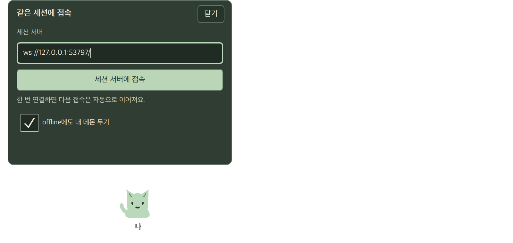
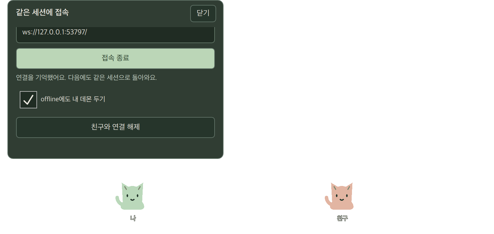

# 실제 클라이언트·재접속·비밀 저장소 검증

2026-10-16 macOS 26.4 arm64, Qt 6.11.2, QtKeychain 0.17.0, CMake 4.4.4/Ninja. Homebrew 공식 qtkeychain 패키지를 사용했다. 제품 기본 실행은 실제 연결이며 `--preview`만 고정 로컬 장면이다. 인터넷에 배포하지 않았다.

## 연결과 복구

- CredentialStore는 서버 URL·프로필별 namespace로 OS 비밀 저장소만 사용한다. 저장 완료 전 인증하지 않고, 손상·읽기·쓰기·삭제 오류는 닫힌 실패로 처리한다. QSettings/파일 fallback을 끈다. register/auth의 토큰을 공개 controlResult·QML·URL query·로그로 전달하지 않는다.
- SessionClient는 실제 QWebSocket을 사용한다. loopback literal IP의 WS와 WSS만 허용하며 userinfo/query/fragment/비-root path를 거부한다. 인증서 오류를 무시하지 않는다. 테스트용 localhost 인증서/키는 공개 fixture이며 배포 키가 아니다.
- 1/2/4/8/15초 + jitter, 최대 15초 재접속과 heartbeat를 제공한다. 오래된 소켓 callback은 generation으로 무시한다. 명령은 자동 재전송하지 않는다. 요청·메시지·송신 버퍼·중복 ID/epoch 기억은 유한하게 제한한다.
- 서버 확정 이벤트의 epoch/revision을 따르며 중복은 무시하고 gap은 snapshot을 요청한다. 최근 과거 epoch를 무시하면서 세션 수명 전체에 epoch 변경 횟수 제한을 두지 않는다.
- WIP·쪽지·받은 항목 정리는 정확한 요청 ID의 확정 이벤트로 완료한다. payload도 검증한다. 이벤트 없는 성공 응답은 전달 불확실로 표시하고 snapshot을 복구한다. timeout/연결 단절에서도 초안을 보존하고 중복 발송을 피한다.
- 첫 연결은 코드 만들기/입력/발급자 승인이다. 참여 요청은 조용한 안내만 띄우고 창/포커스를 자동으로 열지 않는다. 명시적 연결 해제는 서버 폐기를 확인한 뒤 자격증명을 지우고 양쪽 자동 재접속을 중단한다. 실패하면 성공으로 표시하거나 자격증명을 버리지 않는다.
- offline 상대는 숨기고 내 데몬은 설정으로 유지할 수 있다. 받은 항목과 열린 초안은 같은 identity의 presence/snapshot 갱신에서 유지한다. 프로필별 QLockFile로 같은 기기 identity의 중복 실행을 막는다.

## 재현과 검사

초기 stub에 CredentialStore 오류·격리·손상 검사를 실행해 실패를 확인했다. 실제 loopback 서버를 사용하는 연결/승인·재실행·stale socket·중복·gap·offline 쪽지·TLS·해제·WIP/busy/선물·timeout·토큰 비노출 검사도 RED→GREEN으로 구현했다. 전달 불확실 응답, 같은 ID의 다른 text, 32회 초과 epoch 변경 경계도 실패 재현 후 통과했다.

전체 CTest **18/18 그룹**: 공통 codec/reducer, 서버 인증/Broker, 모델/QML, 창/mask/패널과 credentials/client/connection_ui. 일반 CTest는 메모리 secret backend로 격리하고 네트워크는 실제 loopback 소켓을 사용한다. 가짜 UI 객체는 연결 화면 조작 검사에만 쓴다.

실제 Cocoa 선택 검사에서 OS Keychain 쓰기/읽기/삭제가 통과했다. 두 기기가 승인 후 같은 세션에 들어오고, 재실행한 한쪽이 같은 peerId로 복귀하며 Unicode 쪽지를 전달하고 연결 해제 후 키를 정리했다. 실제 네이티브 WIP 버튼 → SceneModel 요청 ID → 소켓 → Broker 확정 이벤트의 동일 ID와 저장 완료도 확인했다. 첫 headless Keychain 검사 실패는 macOS completion의 main dispatch queue를 QCoreApplication이 처리하지 못한 테스트 harness 문제였다. QGuiApplication 기반 native 검사로 재현/해결했으며 제품은 기존 QApplication을 사용한다.

사용자가 보고한 조합 중 WIP 저장 버튼 비활성화를 먼저 재현했다. WIP/쪽지의 유효한 preedit까지 초안으로 검증하고 한 번 클릭하면 조합 완료 뒤 저장한다. 실제 Cocoa에 주입한 한글 preedit/commit 회귀가 통과했다. 실제 OS 입력기 사용자가 이번 수정 이후 재확인한 것으로 확대 해석하지 않는다.

시각 검사는 자체 앱 표면의 서버 입력/승인/연결 완료/작은 영역을 두 배치로만 캡처했다. 아래 이미지는 최종 배치다. 외부 창·메모 본문·기기 토큰·초대 코드를 포함하지 않는다.

## 남은 검증

Task8: 인터넷 WSS/TLS 종료와 호스트, 설치/서명 산출물, 두 프로세스의 전체 제품 시나리오·30분 부하/포커스, 두 실제 컴퓨터 사용. Linux KDE Wayland와 실제 Linux OS 비밀 저장소/입력기는 사용자 요청대로 완성본을 보여준 뒤 검증한다. macOS 오버레이의 기존 미확인 항목은 [기록](overlay.md)을 유지한다. loopback·주입 IME·논리 배율 검사는 외부 서버/실제 입력기/KWin 검증의 대체 증거가 아니다.
