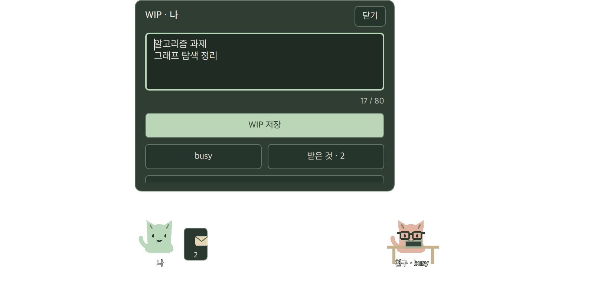
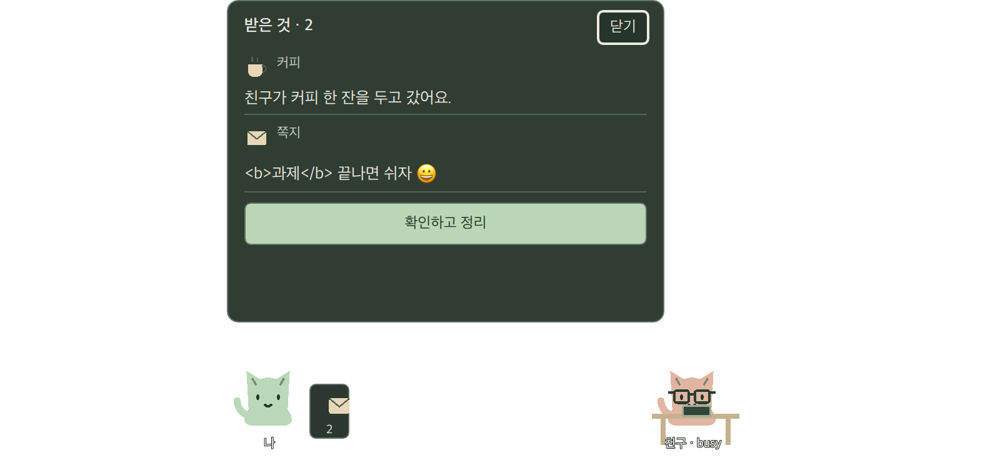

# WIP·쪽지·받은 항목 패널 검증

macOS 26.4 arm64, Qt 6.11.2, CMake/Ninja. 제품 앱은 고정된 두 기기의 로컬 미리보기이며 SessionClient와 연결하지 않았다. 승인한 고양이·색·WIP/ping/busy 표현을 유지하고 새 작업 관리 기능이나 채팅 기록을 추가하지 않았다.

## 동작

- 펫 클릭은 WIP를 연다. 자기 WIP만 수정·빈 값 삭제가 가능하고 친구 WIP는 일반 텍스트로 읽는다. 친구 패널에서 장난·선물 메뉴 또는 쪽지로 이동한다.
- 내 WIP에서 busy와 받은 항목을 연다. 기존 움직임 줄이기·앱 종료는 ‘움직임·앱 메뉴’로 연결한다. 메뉴바/트레이는 내 펫·친구 펫·받은 것·종료를 제공한다.
- WIP 80, 쪽지 120 Unicode code point를 공통 C++ command 검증으로 확인한다. QML의 UTF-16 길이 제한으로 이모지를 자르지 않는다. trim도 동일한 C++ 함수를 쓴다. 여러 줄 편집기는 실제 TextArea를 내부 ScrollView에 두고 커서를 따라 스크롤하며 다른 컨트롤 위로 글자가 넘치지 않게 clip한다. 빈 쪽지·깨진 surrogate·초과 입력·offline 발송은 비활성화한다.
- 저장·발송·확인은 의도만 내보내고 확정 이벤트 전 상태를 변경하거나 성공으로 닫지 않는다. 쪽지는 자신의 일치하는 확정 이벤트에만 닫힌다. 거부 시 열린 초안을 유지하고 재시도 안내를 표시한다. 상황 안내는 이벤트의 문구다.
- 받은 커피·에너지음료·쪽지는 자기 패널에서만 읽고 명시적인 ‘확인하고 정리’ 후 비운다. 다른 친구의 받은 목록을 열거나 확인할 수 없다. offline에서도 전달받은 내용을 읽는다. busy 중 수신·busy 해제는 창·말풍선을 자동으로 열지 않는다.
- 열린 패널만 입력 mask에 추가한다. Tab/Shift+Tab 포커스는 스크롤 안으로 이동하고 긴 받은 목록은 Page Up/Down으로 읽는다. Escape는 이전 행동 메뉴 또는 수동 표시 모드로 돌아간다. Enter는 메모의 줄바꿈이다. 조합 글자를 포함한 초안을 검증해 버튼을 활성화하고, 버튼을 누르면 조합을 확정한 뒤 저장/발송한다.

메모 초안은 열린 패널에서만 보관한다. 직접 닫기/다른 화면으로 이동/현재 snapshot 초기화/앱 종료 시 별도 저장하지 않는다. 실제 재접속 중 편집 유지와 네트워크 오류의 요청 ID 연결은 Task7 통합 시 확인한다. 이미 전달받은 내용은 현재 세션 상태에 남으며 offline 우편 발송은 없다.

## 검증 증거

`ctest --test-dir build --output-on-failure`로 전체 15개 검사 그룹을 실행한다. 패널 QML 검사는 소유권, 공백 삭제, 빈 쪽지, 80/120 이모지 경계, 잘못된 surrogate, 태그를 문자로 표시, busy 조용한 수신, offline, 확정 이벤트 대기, 오류 후 초안 유지, 작은 화면과 양방향 키보드 이동·목록 읽기를 포함한다.

실제 Cocoa의 `build/tests/tst_panelswindow`에서 트레이 action→WIP, 별도 작업창→편집→Escape→작업창 포커스 복귀, 패널 mask 제거, QInputMethodEvent의 preedit/commit을 검사했다. 조합 중 한 번의 저장/발송 클릭을 받아 commit 완료 뒤 한글·이모지·줄바꿈·태그를 그대로 내보낸다. 이 주입 검사를 실제 OS 입력기 시험과 구별한다.

2026-10-16 사용자 실기 확인: 열린 미리보기의 한국어 입력기로 ‘한글 과제’ 입력·저장, 조합 중 잘림/조기 저장 없이 정상이라고 답했다. 자동화의 한국어 입력기 전환 메뉴 읽기는 시간 초과되어 반복하지 않았다. 사용자 확인은 이 시나리오의 증거이며 모든 IME 환경의 보장을 뜻하지 않는다. 실제 Linux 입력기 검사는 사용자 요청대로 공개 이후다.

경계 테스트 중 Qt JSON이 문자열 시작의 raw UTF-8 U+FEFF를 인코딩 마커처럼 소비함을 공통 command/event와 wire 봉투 왕복에서 재현했다. 원본의 UTF-8·JSON 문법을 먼저 검증한 뒤 입력·출력 JSON의 U+FEFF를 표준 `\ufeff`로 escape해 그대로 보존한다. 잘못된 escape가 이 변환으로 유효해지지 않는 명령/봉투 회귀를 포함하고 기존 필드/크기 검증도 유지했다. 공통 codec과 QML 저장 완료 회귀가 RED→GREEN으로 통과했다.

시각 확인은 실제 Cocoa의 WIP·쪽지·받은 항목·작은 영역을 한 번에 캡처하고 최대 한 번만 확인 캡처한다. 두 차례의 캡처를 모두 사용했으며 PNG는 앱 자체와 승인된 fixture만 담는다. 저장된 이미지는 리뷰 후 추가한 입력기 내부 스크롤 수정 전이다. 수정 후에는 재현 검사·실제 Cocoa IME/포커스·전체 회귀로 검증하고 추가 캡처하지 않았다. 이미지 표시상 펫이 빠져 보인 경우도 저장된 PNG의 민트/책상 픽셀은 세 상태에서 동일했으며 이를 렌더러 결함으로 오인해 수정하지 않았다.

## 남은 범위

실제 SessionClient/OS 비밀 저장소/재접속/외부 WSS, 두 컴퓨터 연결과 패키징은 후속 단계다. 시스템 트레이의 실제 OS별 키보드 진입·Dock/작업 영역 변화·투명 클릭 가장자리의 남은 검증은 [기존 오버레이 기록](overlay.md)을 유지한다. 개발용 네모 probe는 사용자가 요청해 실행 프로세스만 종료했으며 회귀 테스트/검증 소스는 보존한다.

Qt API 참고: [TextArea](https://doc.qt.io/qt-6.11/qml-qtquick-controls-textarea.html), [QSystemTrayIcon](https://doc.qt.io/qt-6.11/qsystemtrayicon.html).
