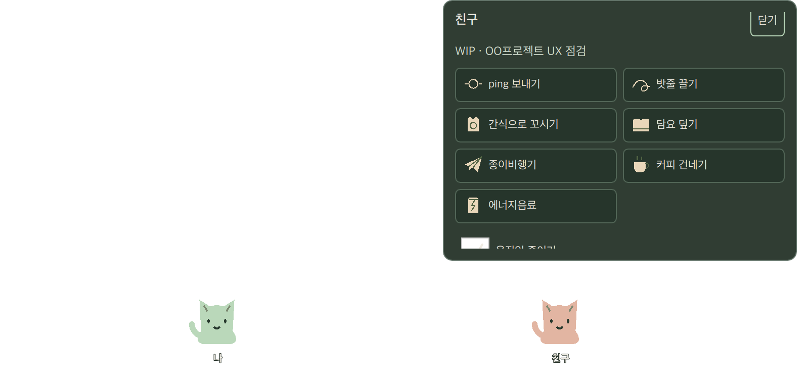
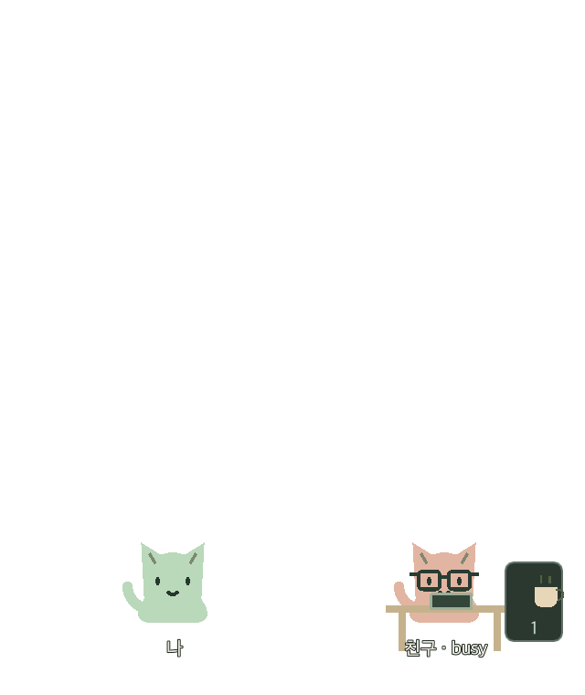

# QML 펫 장면 검증

macOS 26.4 arm64, Qt 6.11.2, CMake/Ninja에서 승인 HTML 목업의 민트·살구 고양이와 소품을 QML로 옮겼다. `daemon-session`은 현재 고정된 두 기기의 로컬 미리보기이며 온라인 Client와 연결하지 않는다. 실제 친구 접속을 재현한 결과가 아니다.

## 구현과 경계

SceneModel은 snapshot과 서버 확정 이벤트를 받아 위치·busy·WIP·받은 항목을 변경한다. 말풍선은 이벤트의 값을 그대로 표시한다. 이미 적용한 revision은 다시 연출하지 않고, gap·다른 epoch·일관되지 않은 이벤트는 snapshotRequired로 복구를 요청한다. Snapshot은 기존 연출과 메뉴를 닫고 현재 상태로 즉시 돌아온다.

ActionMenu의 요청은 검증된 의도만 signal로 내보낸다. 서버 이벤트 전에 성공 상태를 확정하지 않는다. 미리보기 실행 파일에서는 동일한 공통 reducer를 로컬로 연결한다. WIP 편집, 쪽지·받은 항목 패널, SessionClient와 비밀 저장소는 다음 단계다.

Rope/Lure는 모델의 최종 위치를 즉시 확정하고 약 1.8초의 표시 이동만 더한다. 다른 행동이나 중단 후에도 위치는 유지된다. ping·커피·에너지음료·비행기는 짧은 반응을 보이고, 담요는 잠깐 덮인다. 소품 시작·끝은 현재 펫 위치를 따른다. busy는 안경·책상, 새 선물·쪽지는 옆의 작은 개수로 표시하며 메뉴나 말풍선을 자동으로 열지 않는다.

움직임 줄이기는 메뉴/`--reduced-motion`으로 설정한다. idle 걷기와 반응 이동을 생략해도 최종 위치·말풍선·받은 개수는 유지한다. 현재는 OS 설정 자동 연동 및 설정 영속 저장은 없다.

## 오버레이 입력과 포커스

제품 장면은 높이 380 논리 px의 투명 하단 창이다. 기존 probe는 기본 180px를 유지한다. 화면의 availableGeometry보다 높아지지 않으며, 메뉴가 작은 영역에 맞지 않으면 스크롤할 수 있다. 코드 편집기 배경과 목업 송신자 선택기는 넣지 않았다.

아바타·이름·busy 책상·선물 버튼·열린 메뉴의 실제 변환 좌표로 input mask를 갱신한다. 말풍선·밧줄·비행기는 장식 영역으로 입력을 가로채지 않는다. 펫을 직접 누르거나 `--menu`로 명시적으로 열 때만 키보드 입력 모드로 바꾼다. Tab/Shift+Tab, Enter, Escape로 메뉴를 조작한다. 전역 키보드 진입점인 트레이 메뉴는 후속 패널 단계다.

실제 Cocoa에서 데몬 클릭으로 메뉴가 열리고 접근성 트리에 일곱 행동이 표시되는 것을 확인했다. 별도 프로세스의 작업창을 전면에 둔 채 수신 전후 `isActive`와 TextInput의 `ab` 입력 유지도 확인했다. 미리보기의 `--demo-receive`는 5초마다 로컬 수신 이벤트를 만들며, 수신 전후 overlay 활성 여부·앱 활성 여부·revision만 기록한다. 화면 내용·키 입력·메모 본문은 기록하지 않는다.

재현하려면 별도 터미널에서 실행한다:

```sh
./build/desktop/daemon-session.app/Contents/MacOS/daemon-session --demo-receive > /tmp/daemon-pet-focus.log 2>&1
```

첫 수신 로그가 생긴 뒤 다른 터미널에서:

```sh
PET_EXISTING_PREVIEW_LOG=/tmp/daemon-pet-focus.log ./build/tests/tst_petwindow receivedEventKeepsSeparateWorkbenchFocus
```

이 검사는 실제 GUI가 필요하다. offscreen에서는 명시적으로 건너뛰며, offscreen 성공을 native 입력 증거로 대신하지 않는다. 실제 KWin Wayland 125%, Dock/패널 변화, 작업 영역과 일부 클릭 가장자리의 남은 항목은 [기존 기록](overlay.md)에 유지한다.

## 자동 검사와 시각 확인

`ctest --preset dev`에 SceneModel, Qt Quick Test, 실제 OverlayWindow mask의 100%/125% 조건, 앱 smoke를 추가했다. 두 QML 장면의 같은 이벤트·문구·정규화 위치, 이동 후 자리 유지, snapshot 중단, reduced motion, busy 조용한 쌓기, 소품 경계·메뉴 동작을 검사한다. native mask 검사와 별도로 저장된 픽셀에서 메뉴 종료 후 두 펫의 색상이 유지되는 것도 검사한다.

offscreen 플랫폼은 native mask를 적용하지 못한다는 Qt 경고를 낼 수 있다. 해당 검사는 논리 영역의 회귀 검사이며 실제 클릭 통과 판정은 Cocoa 검증과 구별한다. optional capture와 native focus 검사에는 각 실행 조건이 있다.

시각 검사는 두 번의 일괄 캡처로 제한했다. 최초 캡처는 앱과 다른 native control style이 선택돼 최종 증거에서 제외했다. 최종 캡처는 앱의 Basic 스타일과 기본 macOS 렌더러로 확인했다. 아래 PNG는 투명한 앱 자체와 승인된 fixture만 담으며 사용자의 다른 창은 포함하지 않는다.




